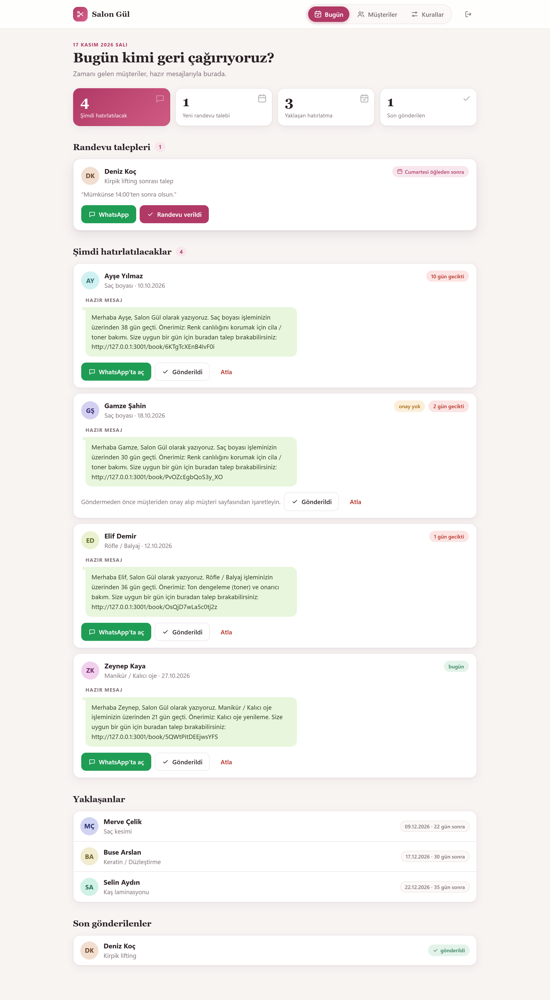
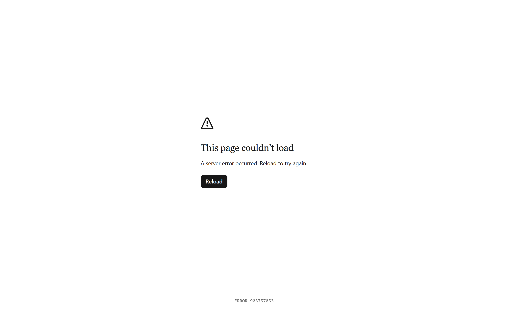
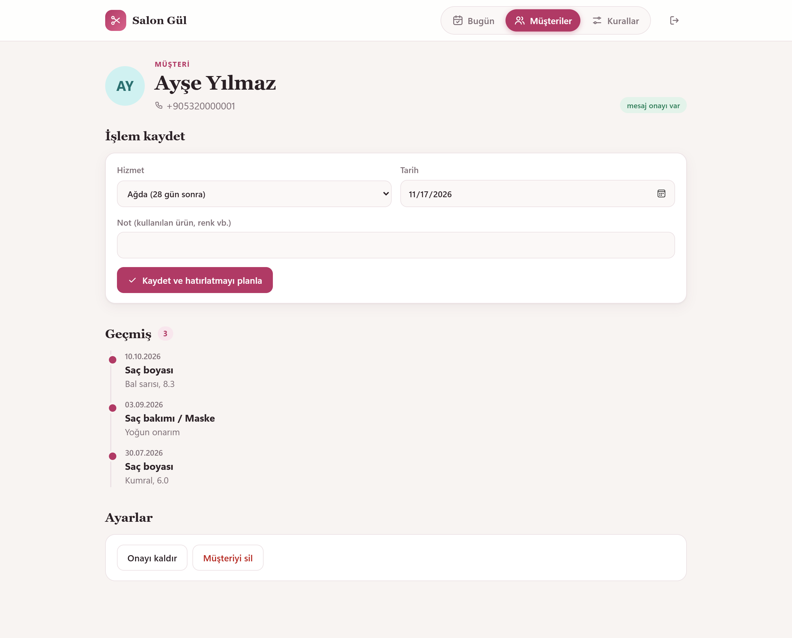
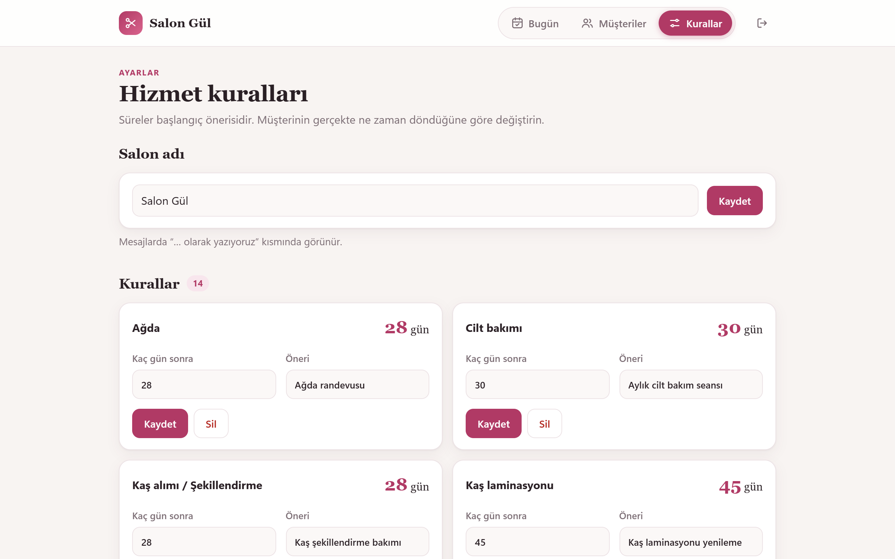
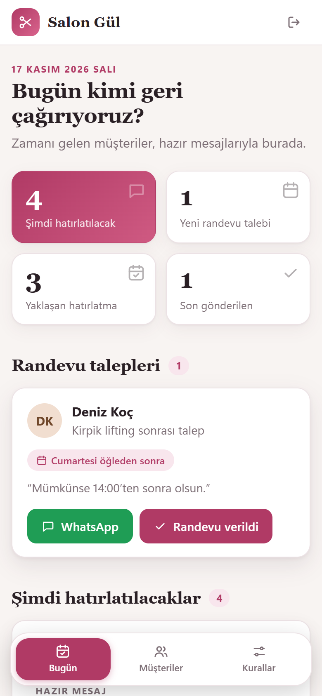
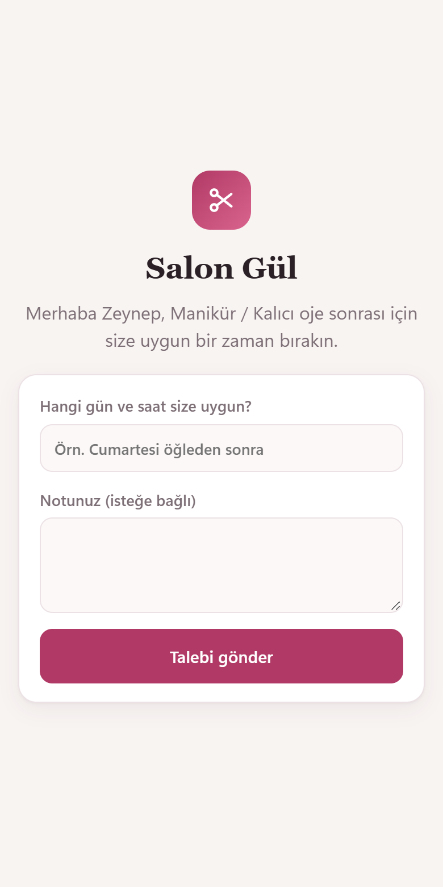
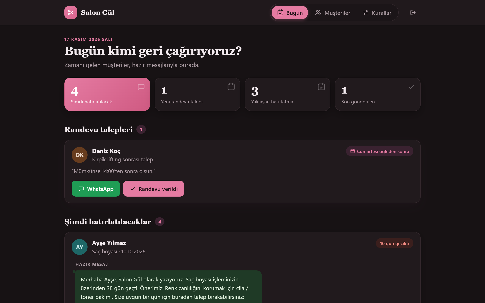

# Salon Management

**Bring salon clients back at the right time.** *(Tr: Müşterilerinizi doğru zamanda geri getiren hatırlatma asistanı.)*

Small beauty salons lose money when clients quietly stop coming back. Salon Dönüş tells the owner **who is due to return today** and prepares a ready-to-send WhatsApp message with a one-tap booking-request link. The follow-up timing depends on the **service** (a gloss/toner about four weeks after a colour, a lash lift after seven), not on a generic schedule.

> **Status: working prototype / portfolio project.** It has not been validated with real salons yet, and the default follow-up intervals are starting guesses. The screenshots below use fictional demo data.

<p align="center">
  
</p>

## How it works

1. The salon adds a client and ticks whether the client agreed to receive reminder messages.
2. After a service, the owner logs it (service, date, note). A reminder is scheduled automatically from that service's rule.
3. When the day comes, the **Today** screen shows the client with a prepared message. One tap opens WhatsApp with the text prefilled; the owner presses send.
4. The message contains a private link. The client leaves a preferred time, and the request appears on the owner's Today screen.

| Clients | Client history | Service rules |
|---|---|---|
|  |  |  |

| Phone (owner) | Phone (client booking page) | Dark theme |
|---|---|---|
|  |  |  |

## Features

- Client list with search and a per-client **message consent** flag. Reminders are not offered for sending without consent.
- Per-service rules: days until follow-up and a suggestion line that goes into the message. 14 starter services (colour, balayage, keratin, brows, lashes, nails, waxing, skin care…), all editable.
- **Today** screen: due reminders with "days late" badges, ready message preview, WhatsApp button, "mark as sent" and "skip".
- Public booking-request page (`/book/<token>`): unguessable token, noindex, at most three open requests per reminder.
- Single-salon password login (httpOnly, HMAC-signed cookie), checked in every page and Server Action.
- Responsive layout with a bottom tab bar on phones, light and dark themes.

## Deliberately not included

- **No automatic sending.** A person sends each message from WhatsApp. This avoids WhatsApp Business API setup and keeps a human in the loop.
- No messages to clients without the consent flag.
- No multi-salon accounts, billing, calendar or POS integration.

## Tech

Next.js 16 (App Router, Server Actions), React 19, TypeScript, SQLite through Node's built-in `node:sqlite`, plain CSS with design tokens. No UI or ORM libraries.

## Run

Requires Node 22.5+ (built-in `node:sqlite`).

```bash
npm install
cp .env.example .env.local   # then set SALON_PASSWORD and SESSION_SECRET
npm run dev
```

Open http://localhost:3000. Data lives in `data/salon.db` (git-ignored). Optionally set `PUBLIC_URL` so booking links in messages use your public address, and `SALON_DATA_DIR` to store the database elsewhere.

### Demo data

To explore the app with fictional clients (and to regenerate the screenshots) use a separate database so real data is never touched:

```bash
SALON_DATA_DIR=./data-demo node --experimental-strip-types scripts/seed-demo.ts
SALON_DATA_DIR=./data-demo npm run dev
```

The seed script refuses to run without `SALON_DATA_DIR`.

## Before using it with real clients

Sending commercial messages in Turkey requires the client's consent and, for commercial messages, İYS registration (not verified here, check the current rules). The consent flag in this app is a reminder for the owner, not legal compliance. Personal data (names, phone numbers) is stored in plain SQLite; review KVKK obligations before real use.

## What I would do next

- Run a short pilot with two or three salons and replace the guessed intervals with observed return times.
- Measure how many reminders turn into booking requests, which is the only number that proves the idea.
- Only then consider sending through the WhatsApp Business API.
